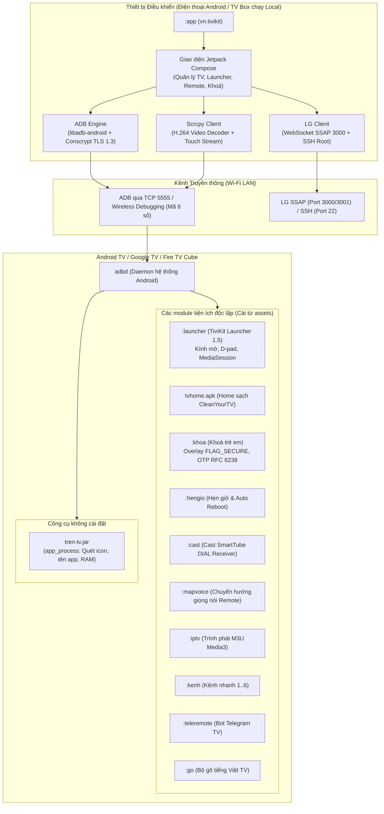

# Kiến trúc Hệ thống & Phân tích Module TiviKit

Tài liệu này mô tả chi tiết kiến trúc tổng thể, mô hình giao tiếp liên tiến trình (IPC), các giao thức mạng và trách nhiệm của từng module trong dự án **TiviKit**.

---

## 1. Mô hình Kiến trúc Tổng thể

TiviKit được thiết kế theo kiến trúc **Bộ điều khiển Trung tâm (Controller)** kết hợp **Dịch vụ Tiện ích Nhúng (Embedded Helpers)**:

---

## 2. Phân tích Chi tiết 11 Module Gradle

### 2.1. Module `:app` (Ứng dụng Điều khiển Trung tâm)
- **Tên gói:** `vn.tivikit`
- **Công nghệ:** Kotlin 2.0, Jetpack Compose, Coroutines/Flow, AndroidX WorkManager.
- **Nhiệm vụ chính:**
  - Giao diện người dùng trên điện thoại hoặc TV Box (thích ứng màn hình cảm ứng lẫn D-pad TV).
  - Quản lý vòng đời kết nối ADB qua TCP (`libadb-android`) và Wireless Debugging (ghép đôi TLS mã 6 số qua `AdbKeyPair` tạo bằng Bouncy Castle).
  - Quản lý dữ liệu mẫu thiết bị (`app/src/main/assets/du-lieu.json` với hơn 450 mẫu TV).
  - Điều khiển màn hình thời gian thực qua kênh Scrcpy (nhúng `scrcpy-server.jar v5.0.1`).
  - Hỗ trợ điều khiển TV LG webOS qua giao thức WebSocket SSAP và SSH root tự động cài LG TV Vibehack.

### 2.2. Module `:launcher` (TiviKit Launcher 1.5)
- **Tên gói:** `vn.tivikit.launcher`
- **Nhiệm vụ chính:**
  - Giao diện Home màn hình lớn chuẩn TV (Leanback / TV Focus API).
  - Hiệu ứng kính mờ (Frosted glass) với thuật toán Stack Blur tối ưu hoá RGB_565 chạy mượt trên Android 8 đến 14.
  - Dock ứng dụng thông minh: Tự động phân tách app đã ghim và app mở gần đây thông qua `UsageStatsManager`.
  - Thẻ **Đang phát**: Bắt sóng `MediaSessionManager` để hiển thị bài nhạc/video đang phát của SmartTube/YouTube Music, hỗ trợ tạm dừng và phát tiếp trực tiếp từ remote.
  - Tích hợp Lịch âm Việt Nam (thuật toán Hồ Ngọc Đức), thời tiết Open-Meteo và Kinh Pháp Cú hàng ngày.

### 2.3. Module `:khoa` (Khóa Trẻ Em & Bảo mật Phụ huynh)
- **Tên gói:** `vn.tivikit.khoa`
- **Nhiệm vụ chính:**
  - Dịch vụ trợ năng (`KhoaDichVu`) chạy ngầm giám sát gói ứng dụng đang hiển thị trên cùng (`AccessibilityEvent.TYPE_WINDOW_STATE_CHANGED`).
  - Tạo cửa sổ lớp phủ hệ thống (`WindowManager.LayoutParams.TYPE_ACCESSIBILITY_OVERLAY`) kèm cờ `FLAG_SECURE` để che màn hình khi đến giờ khóa hoặc khi mở app bị giới hạn.
  - Xác thực hai lớp: Mã OTP 6 số biến đổi mỗi 30 giây theo chuẩn **RFC 6238** (tương thích Google Authenticator) cùng 10 mã dự phòng 8 số băm muối SHA-256.
  - Cơ chế **Fail-closed**: Nếu dịch vụ trợ năng bị ngắt kết nối mà khóa đang bật, hệ thống tự động từ chối truy cập cho đến khi xác thực thành công.

### 2.4. Module `:cast` (Cast SmartTube DIAL Receiver)
- **Tên gói:** `vn.tivikit.cast`
- **Nhiệm vụ chính:**
  - Triển khai giao thức DIAL 1.7 (Discovery and Launch) qua HTTP SSDP multicast `239.255.255.250:1900`.
  - Giả lập máy chủ Lounge pairing của YouTube, cho phép ứng dụng YouTube trên iPhone/Android tìm thấy TV và truyền video sang SmartTube mà không cần mã TV thủ công.
  - Quản lý danh sách điện thoại đã ghép đôi, cấp quyền theo phiên (cho phép luôn, 24 giờ, hoặc chặn thiết bị lạ).

### 2.5. Module `:mapvoice` (Chuyển Hướng Giọng Nói Remote)
- **Tên gói:** `vn.tivikit.mapvoice`
- **Nhiệm vụ chính:**
  - Kết nối vào ADB nội bộ của chính TV (`127.0.0.1:5555`) để lắng nghe luồng logcat từ Trợ lý Google (`katniss_interactor_StreamingTextView`).
  - Bắt các khẩu lệnh tiếng Việt như *"mở nhạc piano"*, *"xem VTV3"* để chuyển hướng tự động mở bằng SmartTube hoặc các ứng dụng truyền hình (VTVgo, TV360, FPT Play, IPTV) thay vì mở YouTube gốc có quảng cáo.

### 2.6. Module `:hengio` (Hẹn Giờ Bật Tắt & Auto Reboot)
- **Tên gói:** `vn.tivikit.hengio`
- **Nhiệm vụ chính:**
  - Lập lịch bật/tắt TV và mở kênh truyền hình tự động bằng `AlarmManager`.
  - **Auto Reboot**: Tự động khởi động lại TV vào ban đêm (mặc định 04:00 sáng) khi TV đang tắt màn hình thông qua lệnh `reboot` gửi tới ADB loopback, giúp dọn dẹp RAM và giữ TV luôn mượt mà.

### 2.7. Module `:iptv` & `:kenh` (Trình Phát IPTV & Kênh Nhanh)
- **Tên gói:** `vn.tivikit.iptv` & `vn.tivikit.kenh*`
- **Nhiệm vụ chính:**
  - `:iptv`: Trình phát luồng video Media3 (ExoPlayer) tối ưu riêng cho TV, đọc playlist M3U/M3U8 từ bộ nhớ hoặc URL từ xa, tự động chuyển luồng dự phòng.
  - `:kenh`: Các shortcut độc lập (tối đa 6 ô kênh) gán trực tiếp lên thanh Dock hoặc nút số remote để mở đài truyền hình yêu thích chỉ bằng 1 thao tác.

### 2.8. Module `:teleremote` (Bot Telegram Điều Khiển TV)
- **Tên gói:** `vn.tivikit.teleremote`
- **Nhiệm vụ chính:**
  - Chạy một Telegram Long-polling Bot trực tiếp trên TV, cho phép người dùng điều khiển TV từ bất kỳ đâu qua Telegram mà không cần mở cổng modem (NAT/Port Forwarding).
  - Hỗ trợ gửi tin nhắn lên màn hình TV, chụp ảnh màn hình, kiểm tra mạng, dọn RAM và hẹn giờ tắt từ xa.

### 2.9. Module `:go` & `:trentv` (Tiện Ích Nhập Liệu & Công Cụ Hệ Thống)
- **Module `:go` (`vn.tivikit.go`):** Bàn phím ảo IME phụ trợ gõ tiếng Việt có dấu chuẩn Telex/VNI trên TV khi điều khiển từ xa.
- **Module `:trentv` (`tren-tv.jar`):** Được biên dịch thành file DEX/JAR đóng gói sẵn trong assets. Khi app điều khiển cần lấy thông tin chi tiết (tên app chuẩn, icon bitmap chất lượng cao), nó đẩy file này vào `/data/local/tmp` và gọi qua `app_process / vn.tivikit.trentv.TenApp` để đọc dữ liệu tốc độ cao mà không cần cài thêm package nào vào Android.

---

## 3. Giao thức Kết nối & An toàn Hệ thống

### 3.1. ADB qua Wi-Fi
- **Port 5555:** Sử dụng cho các thiết bị Android TV truyền thống (Android 8 - 10) hoặc TV Box đã kích hoạt `setprop service.adb.tcp.port 5555`.
- **Wireless Debugging (Mã ghép đôi 6 số):** Dành cho Google TV đời mới (Android 11+). App sử dụng `AdbKeyPair` tạo khoá RSA-2048 động kết hợp giao thức mDNS để tự động quét cổng ngẫu nhiên và hoàn tất bắt tay TLS.

### 3.2. Cơ chế Canh gác (Watchdog) Bảo vệ TV
Khi người dùng thay đổi Launcher mặc định, TiviKit tự động thiết lập một tiến trình giám sát nền (`watchdog`) trong 3 phút trên TV:
1. Ghi hạn bảo vệ vào `/data/local/tmp/tivikit-gac-han`.
2. Nếu sau 3 phút điện thoại mất kết nối, hết pin hoặc TV gặp sự cố crash, tiến trình watchdog sẽ tự động khôi phục Launcher gốc của nhà sản xuất, đảm bảo TV không bao giờ bị rơi vào tình trạng màn hình đen hoặc mất launcher.
